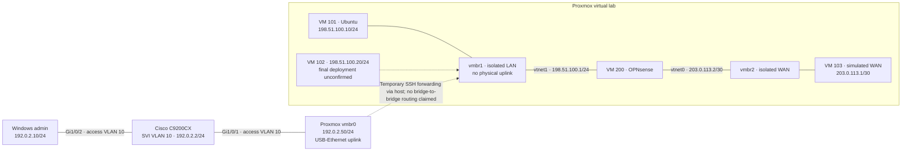

# Enterprise Network Security Lab

**Cisco switching · Proxmox virtualization · Ubuntu networking · OPNsense firewall engineering**

An engineering portfolio tracing a real lab from physical management connectivity to isolated virtual networks, routed ICMP tests, stateful filtering and secure GUI administration.

[Architecture & inventory](docs/architecture.md) · [Lab reports](docs/labs/README.md) · [Roadmap](docs/roadmap.md) · [Evidence register](docs/evidence.md)

> **Historical lab baseline:** configuration and outcomes are reconstructed from the owner's training audit. IOS XE version has direct pasted command evidence. Other results retain their reported or screenshot-referenced status; original screenshots and logs are not bundled. This is not a live infrastructure audit or a production-readiness claim.

> **Anonymized examples:** all published infrastructure IP addresses and hostnames are fictional replacements, not actual deployed values. Management uses RFC 5737 TEST-NET-1 (192.0.2.0/24), LAN uses TEST-NET-2 (198.51.100.0/24), and the simulated WAN uses a /30 inside TEST-NET-3 (203.0.113.0/24). Loopback addresses retain their standard meaning. These ranges are for documentation, not public routing or deployment.

## Technology stack

| Platform | Documented work |
| --- | --- |
| Cisco Catalyst C9200CX · IOS XE 17.12.03 / 17.12.3 (Dublin) | Management VLAN, access ports, SSH and access-port protections |
| Proxmox VE · version not supplied | Physical management bridge, isolated LAN/WAN bridges and VirtIO VM networking |
| Ubuntu Server · release not supplied | LAN endpoint, simulated WAN endpoint and return routing |
| OPNsense 26.7 · historical screenshot reference | Pure routing without source NAT, ICMP states and ingress firewall policy |
| Windows administrative PC | Management connectivity, ICMP troubleshooting and local SSH forwarding |

## Current-state topology

This diagram represents the **historical configuration reported by the owner**, not a fresh inspection.

The physical uplink is **access VLAN 10**, not an 802.1Q trunk. VLANs 20 USERS, 30 SERVERS and 40 DMZ exist historically on the switch but are not physically integrated. The untagged virtual LAN subnet does not imply VLAN 20 tagging.

## Practical progress and outcomes

| Workstream | Historical outcome | Evidence available here |
| --- | --- | --- |
| Cisco management | SVI and access ports configured; reachability and Windows ICMP troubleshooting performed | Owner report; IOS XE version supported by pasted output |
| Virtualization | Three bridges mapped; VM 101 startup fixed by removing tag 20 from non-VLAN-aware vmbr1 | Owner report |
| Pure routing | LAN-to-simulated-WAN ping: 10 sent, 10 received, 0% loss; no source NAT | Owner report; original result artifact pending |
| Stateful firewall | State table and Live View inspected; scoped LAN ICMP block observed in logs | Owner report; original log/screenshots pending |
| Reverse-direction policy | Default WAN denial and specific WAN IN ICMP pass studied; experiment reported successful | Owner report; detailed artifacts pending |
| Secure administration | OPNsense HTTPS GUI reached through SSH local TCP forwarding | Owner report; temporary host-address removal not evidenced |
| Lesson 18 | Professional policies, aliases and least privilege | **Planned** |
| Physical VLAN integration | Cisco–OPNsense inter-VLAN forwarding | **Planned** |

## Engineering lessons

- **Routing and filtering are separate:** return routes enabled pure routing; firewall rules decided whether flows passed.
- **Direction is relative to firewall ingress:** LAN-originated requests were filtered on LAN IN.
- **State matters:** matching replies can use an existing state; unrelated new inbound requests require their own permission.
- **Bridge settings matter:** a guest VLAN tag on a non-VLAN-aware bridge prevented VM startup.
- **SSH forwarding is application access:** it does not establish general routing between management and lab bridges.

See [firewall analysis](docs/labs/03-stateful-firewall.md) and [virtualization troubleshooting and GUI access](docs/labs/02-virtual-network.md).

## Documentation

- [Architecture](docs/architecture.md): addressing, VM resources, bridge map and security boundaries.
- [Cisco lab](docs/labs/01-cisco-management.md): management and historical hardening.
- [Virtual network lab](docs/labs/02-virtual-network.md): bridges, startup incident and SSH forwarding.
- [Firewall lab](docs/labs/03-stateful-firewall.md): routed tests, states, block rule and verification matrix.
- [Next lesson](docs/labs/04-firewall-policy.md): planned policy-design exercise.
- [Evidence standard](docs/evidence.md) and [screenshot folders](docs/assets/README.md): provenance and sanitization.
- [Milestones](docs/roadmap.md): completed historical activities versus evidence and future work.

Addresses and hostnames are anonymized consistently across diagrams, reports and command examples; the example-to-real mapping is kept only in private local records outside this repository. Credentials, MAC addresses, serial numbers and account secrets are excluded. No production FH connectivity, deployed FortiGate, VPN, enterprise HA or completed certification is claimed. No license has been selected.
