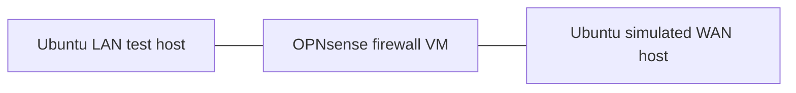

# Enterprise Network Security Lab

**Cisco switching · Proxmox virtualization · Ubuntu networking · OPNsense firewall engineering**

A hands-on engineering portfolio documenting how traffic moves, where security policy applies, and how test evidence supports each conclusion.

> **Status:** foundation documentation in progress. Earlier learning sessions report working experiments; supporting configurations, logs and captures have not yet been added. No release or production-readiness claim is made.

[Architecture](docs/architecture.md) · [Roadmap](docs/roadmap.md) · [Lab reports](docs/labs/README.md) · [Evidence standard](docs/evidence.md)

## Engineering focus

| Area | Platform | Focus |
| --- | --- | --- |
| Switching | Cisco Catalyst C9200CX | Management VLAN, access/trunk design and future segmentation |
| Virtualization | Proxmox VE | Linux bridges, VM interface mapping and network isolation |
| Endpoints | Ubuntu | Addressing, routes, connectivity tests and packet inspection |
| Security | OPNsense | Stateful filtering, policy direction and logged allow/deny decisions |

Exact software versions, switch ports, subnet masks and virtual interface mappings remain to be recorded. Platform inclusion does not imply every feature has been deployed.

## Logical experiment

Both endpoint roles and the firewall are described in the earlier learning-session summary. This is a logical traffic path, not a verified physical wiring diagram. The simulated WAN is a test segment; it does not establish Internet connectivity. See the [architecture and open questions](docs/architecture.md).

## Current documentation baseline

| Workstream | Available information | Evidence status |
| --- | --- | --- |
| Cisco management | Management VLAN configuration reported | Awaiting sanitized running configuration and verification |
| Proxmox and Ubuntu | Virtual LAN/WAN endpoint roles reported | Awaiting bridge, vNIC and route inventory |
| OPNsense fundamentals | Routing, ICMP state tracking, inbound rule direction and firewall logs reported | Awaiting repeatable tests and sanitized artifacts |
| Professional firewall policies | Next learning exercise | Planned |
| Physical VLAN integration | Future integration work | Planned; no working trunk claimed |

## First milestone

**v0.1.0 — Network Foundation & Firewall Fundamentals** will document the existing environment and provide reproducible positive and negative firewall tests. Its [acceptance criteria](docs/roadmap.md) require evidence before completion is claimed.

The progression is **understand → configure → verify → troubleshoot → secure → document**. Fortinet study can complement the lab later; this repository makes no certification or exam-completion claims.

## Documentation map

- [Architecture](docs/architecture.md): component roles, isolation boundaries and missing inventory.
- [Roadmap](docs/roadmap.md): milestones with explicit completion criteria.
- [Lab reports](docs/labs/README.md): Cisco, virtualization and firewall exercises.
- [Evidence and publication](docs/evidence.md): result labels, sanitization and review.

Use only an isolated, authorized lab. Examples are documentation drafts, not deployment instructions for an operational network. No license has been selected yet.
