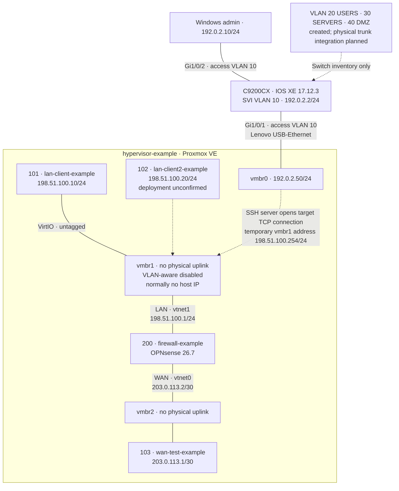

# Architecture

## Scope and provenance

Historical state reconstructed from the owner's lab audit of repository commit `89068b1`, supplied on 2026-11-09. No live device inspection was performed. The supplied Cisco `show version` excerpt directly supports IOS XE 17.12.03 / 17.12.3 (Dublin). OPNsense 26.7 is attributed to a historical console screenshot described by the owner; that image is not available in this repository.

The earlier documentation left addresses and mappings unknown because it lacked this detailed audit. Those gaps are now filled as **historical reported configuration**, not promoted to independently verified current settings. See the [evidence register](evidence.md).

**Anonymization:** every infrastructure address and hostname below is a fictional example, not an actual deployed value. Management is mapped to RFC 5737 TEST-NET-1, LAN to TEST-NET-2 and simulated WAN to TEST-NET-3. Prefix lengths, host relationships, routes, device roles and VLAN IDs are preserved. Documentation ranges are not deployable public network assignments.

## Historical current-state diagram

Dashed links identify an uncertain VM, temporary application forwarding or inventory notes; they are not physical trunks. No general routing path between vmbr0 and vmbr1 is asserted.

## Addressing and bridge inventory

The roles and relationships below reflect owner-reported historical settings. All addresses and hostnames are anonymized RFC 5737 examples; original values and the mapping remain in private local records outside Git.

| Component / interface | Address | Attachment and role |
| --- | --- | --- |
| Cisco management SVI VLAN 10 | 192.0.2.2/24 | Management segment |
| Windows administrative PC | 192.0.2.10/24 | Gi1/0/2, access VLAN 10 |
| hypervisor-example management, vmbr0 | 192.0.2.50/24 | Lenovo USB-Ethernet to Gi1/0/1, access VLAN 10 |
| vmbr1 host interface, baseline | No host IP initially | Isolated LAN bridge; no physical uplink; VLAN-aware disabled |
| vmbr1 host interface, administration experiment | 198.51.100.254/24 temporarily | Host-originated connection to OPNsense GUI; removal not evidenced |
| vmbr2 host interface | Host IP not supplied | Isolated simulated-WAN bridge; no physical uplink |
| VM 101 lan-client-example | 198.51.100.10/24 | VirtIO on vmbr1; gateway 198.51.100.1 for remote networks |
| VM 102 lan-client2-example | 198.51.100.20/24 intended/reported | vmbr1; planned/configured during training, final deployment unconfirmed |
| VM 200 firewall-example, LAN vtnet1 | 198.51.100.1/24 | VirtIO on vmbr1 |
| VM 200 firewall-example, WAN vtnet0 | 203.0.113.2/30 | VirtIO on vmbr2 |
| VM 103 wan-test-example | 203.0.113.1/30 | vmbr2; simulated upstream endpoint |

Management default gateways, physical host NIC identifier, vmbr2 VLAN-awareness setting and other unspecified settings remain unconfirmed.

| VM | Supplied resource / platform detail |
| --- | --- |
| 101 | Ubuntu Server; 2 vCPU, 2 GiB RAM, 20 GiB disk; exact Ubuntu release not supplied |
| 102 | Ubuntu client role; resource allocation and final deployment status unconfirmed |
| 103 | Ubuntu WAN test role; release and resource allocation not supplied |
| 200 | OPNsense 26.7 per historical screenshot reference; two VirtIO interfaces; resources not supplied |

## Forward and return routing

- LAN endpoint sends remote-subnet traffic to `198.51.100.1`.
- OPNsense has LAN `198.51.100.0/24` and WAN `203.0.113.0/30` directly attached.
- VM 103 has a return route for `198.51.100.0/24` via `203.0.113.2`.
- Source NAT was disabled for the pure-routing experiment. A LAN-originated request arriving at the WAN test host therefore retains the LAN source address; the return route is essential.
- WAN private-network blocking was disabled in the original isolated RFC1918 simulation. The public WAN addresses are now TEST-NET examples, not RFC1918 addresses; they preserve topology without changing the historical account of that setting. This is not a recommendation for an Internet-facing WAN.

## Layer 2 boundaries

The Cisco uplink carries access VLAN 10 only. VLANs 20 USERS, 30 SERVERS and 40 DMZ were created, but no 802.1Q trunk or physical Cisco–OPNsense inter-VLAN integration is documented. The example IP subnet `198.51.100.0/24` on vmbr1 does not itself make the bridge a tagged VLAN 20 network. IP numbering and Ethernet VLAN tagging are separate.

vmbr1 and vmbr2 have no physical uplinks in the reported design. The temporary host address on vmbr1 creates host access to that segment without requiring forwarding between bridges. Its removal after administration remains an evidence gap.

## Remaining inventory gaps

Exact switch SKU; Proxmox and Ubuntu versions; management gateways; complete ruleset and VTY source list; endpoint firewall configuration; present-day configuration and temporary-address cleanup. Historical documentation does not require repeating physical switch configuration.

Reference: [Proxmox VE network configuration](https://pve.proxmox.com/wiki/Network_Configuration).
