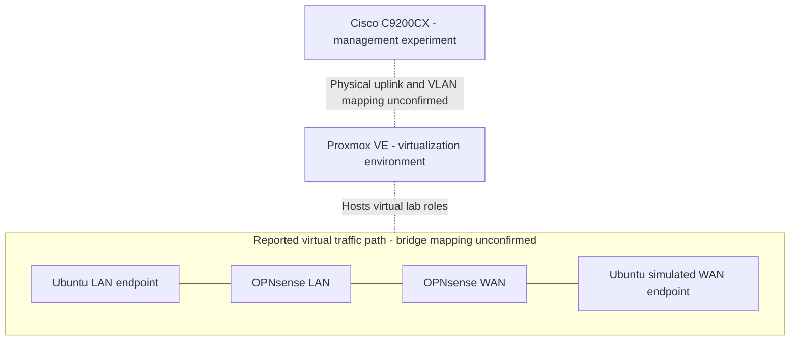

# Architecture

## Scope and confidence

This baseline was reconstructed on 2026-11-09 from the earlier learning-session summary. No device access, configuration exports, packet captures or screenshots were available for independent verification. Addresses and VM identifiers from the private summary are deliberately omitted.

## Component inventory

| Role | Platform | Reported purpose | Still to confirm |
| --- | --- | --- | --- |
| Physical switch | Cisco Catalyst C9200CX | Management VLAN experiment | Exact SKU, IOS XE version, port map and VLAN membership |
| Hypervisor | Proxmox VE | Virtual lab hosting | Version, physical uplinks, bridges, VLAN awareness and vNIC assignments |
| LAN endpoint | Ubuntu VM | Initiates firewall tests | Version, prefix, gateway, routes and local firewall |
| Firewall | OPNsense VM | LAN/WAN routing and filtering | Version, interface assignments, rules, NAT and gateway settings |
| WAN endpoint | Ubuntu VM | Simulates an external-side host | Prefix, return route, services and local firewall |

## Logical topology

Solid links represent the reported logical path only. The two OPNsense interface nodes belong to one firewall VM. Dashed links are relationships awaiting inventory; they are not evidence of a configured trunk.

## Boundaries and design decisions

- Keep the simulated WAN isolated from live upstream networks while testing permissive policies.
- Confirm that no bridge or second endpoint interface bypasses OPNsense. A diagram alone cannot prove isolation.
- Maintain a separate, recoverable management path before changing bridges, switch VLANs or firewall administration rules.
- A bridge provides Layer 2 connectivity; routing, filtering and NAT are separate functions. Do not infer a NAT requirement from successful routing.
- For routed tests without source NAT, the destination must have a return route to the source subnet. If NAT is used, record the translation and test that behavior explicitly.

## Sanitized addressing convention

Public reports use `LAN_TEST_HOST`, `FW_LAN`, `FW_WAN`, `WAN_TEST_HOST` and `MGMT_HOST`. These are role labels, not commands or deployable addresses. Keep the real mapping outside this repository. Record prefix lengths and routes in a reviewed, sanitized inventory before publishing a reproducible numeric example.

## Inventory required before integration

1. Map each VM vNIC to a bridge and each bridge to its uplink, if any.
2. Record switch access/trunk mode, allowed VLANs and untagged/native VLAN behavior.
3. Identify which device routes each segment; avoid assuming switch Layer 3 capabilities or licensing.
4. Record firewall interface roles, default gateway, return routes and NAT mode.
5. Verify management reachability and rollback access before applying changes.

Reference: [Proxmox VE network configuration](https://pve.proxmox.com/wiki/Network_Configuration). Exact settings must be checked against the installed release.
